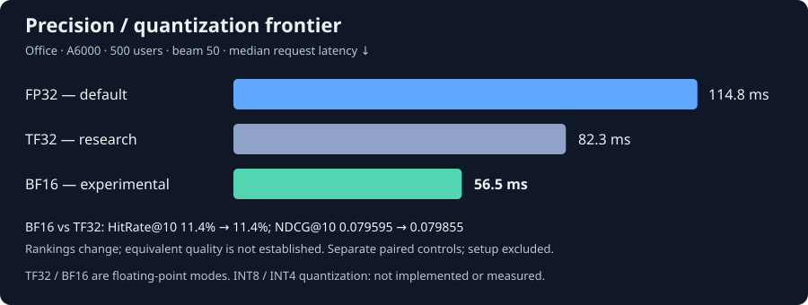

# RapidTinyRec

Faster inference for [MiniOneRec](https://github.com/AkaliKong/MiniOneRec).
Reuse history computation across beams, keep SID constraints on the GPU, and
remove unnecessary KV-head expansion from compiled attention.

**Validated FP32 stack: 114.8 ms median / 119.9 ms p95**, with 7.49 GiB
allocated GPU memory on the 500-user Office/A6000 benchmark. The folded path
preserves every rank and score bit against its paired physical-prefix control
and the historical compiled-GQA baseline. [Supported scope and setup costs](docs/release-scope.md).

The earlier shared-prefill change reduced median latency **869 ms → 188 ms
(4.63×)** with all 25,000 ranked positions unchanged.

Reduced-precision research reached **82.3 ms with TF32** and **56.5 ms with
BF16**. BF16 is available as an **experimental opt-in**; FP32 remains the default.
These modes change rankings; see the
[precision and quality comparison](#reduced-precision-results) below.

## Performance

Office checkpoint · RTX A6000 · FP32 · batch 1 · beam 50. Each row is a separate
paired run on the same 500 users; improvements should not be multiplied together.

| Change | Median, ms | p95, ms | Score equality |
| :--- | ---: | ---: | :--- |
| Prefill once, then expand KV | 868.8 → 187.6 | 1097.7 → 189.4 | Small rounding differences |
| Batch constraint transfers | 186.2 → 166.6 | 187.9 → 168.1 | Bitwise exact |
| GPU constraint lookup | 167.8 → 160.8 | 169.2 → 163.0 | Bitwise exact |
| Restore native GQA in compiled forward | 174.4 → 159.7 | 188.2 → 169.8 | Bitwise exact |
| Replay + direct KV reorder | 136.5 → 131.1 | 144.6 → 138.8 | Bitwise exact |
| Reuse graph input storage | 130.1 → 130.2 | 138.0 → 138.3 | Bitwise exact |
| Share physical history KV | 129.3 → 126.7 | 137.2 → 133.3 | Bitwise exact |
| Fold decode query heads into rows | 127.2 → 114.8 | 133.6 → 119.9 | Bitwise exact |

Every row preserves all 50 ranks for every user against its paired control.
Compilation, capture and warmup are excluded. Full-vocabulary normalization, newline/EOS
probabilities, beam width and model weights are preserved.
[Measurements and limits](docs/benchmarks.md).

Sharing input storage across 40 graphs reduces allocated GPU memory
**29.16 → 18.78 GiB (35.6%)**, with the small latency regression shown above.
[Memory results and setup costs](docs/input-arena.md).

Keeping one physical history copy further reduces allocated memory
**18.37–18.78 → 7.48 GiB (59–60%)** in its paired comparison. Cold setup
increases **140 → 350 s**. [Shared-prefix results](docs/shared-prefix.md).

Packing decode query heads into attention rows reduces median/p95 latency
**9.71% / 10.28%**, with unchanged memory. Cold setup rises **347 → 370 s**.
[Exactness checks and setup costs](docs/folded-query-heads.md).

### Reduced-precision results



Same Office checkpoint, RTX A6000, 500 users, batch 1 and beam 50. Each row is
a separate paired experiment; its control timings must not be substituted
with those from another row. Setup, compilation and capture are excluded.
TF32/BF16 are floating-point precision modes, not INT8/INT4 quantization.

| Paired precision change | Median, ms | p95, ms | HitRate@10 | NDCG@10 | Changed full rank lists |
| :--- | ---: | ---: | ---: | ---: | ---: |
| FP32/TF32 off → TF32 | 114.43 → 82.30 | 119.52 → 83.65 | 11.4% → 11.4% | 0.079595 → 0.079595 | 142 / 500 |
| TF32 → BF16 | 82.21 → **56.53** | 83.60 → **57.64** | 11.4% → 11.4% | 0.079595 → 0.079855 | 500 / 500 |

BF16 reduced median latency **31.23%** against its paired TF32 control. At
HitRate@10, one user improved and one regressed; the paired 95% interval for
the change is **−0.6 to +0.6 percentage points**. NDCG@10 changed by +0.000260
(95% interval −0.001515 to +0.002012). Some prompt-length groups regressed.
These results support a speed/quality tradeoff, not a claim of equivalent
quality or exact rankings. The comparison is BF16 versus TF32, not a direct
paired BF16-versus-FP32 experiment.

These are the completed full500 research measurements; the smaller release
acceptance check does not replace them. BF16 is selectable with
`--precision bf16-experimental`; TF32 remains research-only. INT8/INT4
quantization is neither implemented nor benchmarked.
[Precision recipe, quality limits and source evidence](docs/precision-results.md).

## Run

```bash
pip install torch==2.14.0 --index-url https://download.pytorch.org/whl/cu126
pip install -e .
python -m rapidtinyrec.prepare_release --release-root releases/office
python -m rapidtinyrec.run prefill \
  --release-root releases/office --output-root results/prefill
```

Linux, Python 3.11+, CUDA. [Run every ablation and profiler](docs/reproduce.md).
Release files and the user cohort are pinned and hash-checked; generated outputs
include all rankings, scores and per-request timings.

Run the folded stack with FP32 (default), or explicitly opt into BF16:

```bash
python -m rapidtinyrec.run folded \
  --release-root releases/office --reference-results GQA_RESULTS \
  --output-root results/folded-fp32
python -m rapidtinyrec.run folded --precision bf16-experimental \
  --release-root releases/office --reference-results GQA_RESULTS \
  --output-root results/folded-bf16
```

`GQA_RESULTS` is the pinned historical GQA benchmark directory described in
[reproduction instructions](docs/reproduce.md). These commands run the four-user
acceptance cohort; add `--full-cohort` for all 500 users. Each launch creates a
fresh process and compiler caches. Use a new output directory for every run.
BF16 retains FP32 normalization/beam scores and the same beam width, vocabulary
and EOS policy; it does not promise identical rankings or equivalent quality.

[How decoding works](docs/decoding.md) · [Benchmark evidence](benchmarks/results)
· [Changes](https://github.com/amilcodes/RapidTinyRec/pulls?q=is%3Apr)

Apache-2.0. Built on MiniOneRec; see [NOTICE](NOTICE) for attribution.
