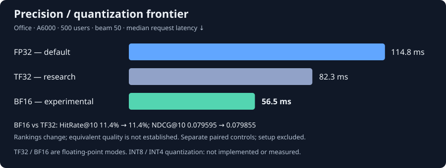

# RapidTinyRec

Faster inference for [MiniOneRec](https://github.com/AkaliKong/MiniOneRec).
Reuse history computation across beams, keep SID constraints on the GPU, and
remove unnecessary KV-head expansion from compiled attention.

**Validated FP32 stack: 114.8 ms median / 119.9 ms p95**, with 7.49 GiB
allocated GPU memory on the 500-user Office/A6000 benchmark. The folded path
preserves every rank and score bit against its paired physical-prefix control
and the historical compiled-GQA baseline. [Supported scope and setup costs](docs/release-scope.md).

The earlier shared-prefill change reduced median latency **869 ms → 188 ms
(4.63×)** with all 25,000 ranked positions unchanged.

Reduced-precision research reached **82.3 ms with TF32** and **56.5 ms with
BF16**. BF16 is available as an **experimental opt-in**; FP32 remains the default.
These modes change rankings; see the
[precision and quality comparison](#reduced-precision-results) below.

### Speedrun engine, certified exact decoding and late entry (research branch)

A from-scratch engine ([`rapidtinyrec/speedrun`](SPEEDRUN.md)) runs a whole request as one
CUDA graph and replaces beam search with **certified exact decoding**: every term of an item's
score is a log-probability ≤ 0, so one forward over the prompt and every first-level trie node
bounds every item, and a second small forward proves when the returned top-K is the global
optimum. **Late entry** makes that second forward cheap: prefix rows start at layer 22 of 28 from
a small bridge distilled from their parent node's state (no labels, frozen model).

| batch 1, 500 Office users, median ms | RTX A6000 | H100 |
| :--- | ---: | ---: |
| HF `generate`, FP32 | 868.8 | — |
| speedrun engine, FP32 | 100.8 | 48.3 |
| BF16, one CUDA graph per request | 42.1 | 20.1 |
| + torch.compile | 35.0 | 12.9 |
| + first trie level fused into the prompt forward + Triton beam attention | 28.1 | 8.50 |
| + FP16 + cached prompt template (top-1 identical to FP32 for 500/500 users) | 26.2 | 8.48 |
| certified exact decoding (trie or tuned codebook scoring) | 14.4 | 5.6 |
| + late entry for the third code | 9.5 | 4.2 |
| + Triton prompt attention in the first forward (+ whole-layer compile, fused K/V stores on the H100) | 9.0 | 3.2 |
| same, codebook(a,b)+trie(c) scoring with the third code weighted 0.75 (validation-tuned) | 9.0 | 3.1 |
| + first-level late entry (layer 18), third code at layer 26 — final paired runs | 6.4 | **2.75** |
| + SASRec term inside the certified search (HR@10 0.1825; precomputed SASRec rows) | **6.4** | **2.72** |
| same, SASRec itself computed inside the CUDA graph from the user's history (end to end) | — | **2.89** |

- Certified decoding proves its top-10 globally optimal for ≥99.7% of users (0 violations
  against brute force). The fastest configuration also scores best: with codebook normalization
  for the first two codes, trie normalization for the third and the third code weighted 0.75
  (chosen on MiniOneRec's validation split), HR@10 rises from 0.1589 to 0.1712 on all 4,866 Office
  test users (+1.23 pt [+0.66, +1.81]). On Industrial & Scientific it matches MiniOneRec's own
  beam-50 (HR@10 0.1597 vs 0.1582, n.s.) at 9.4 ms vs 25.8 ms on the A6000 and 3.2 ms vs 8.4 ms on the H100.
- Late entry is statistically indistinguishable from the full-depth second forward on HR@10 and
  NDCG@10 on both datasets (6 of 28 layers on Office, 10 on Industrial; bridges trained on the
  validation split only).
- Large candidate lists stay cheap: certifying the top K needs ≈K prefixes, and only multi-child
  prefixes need the second forward. Certified top-500 takes 6.1 ms on an H100 vs 18.1 ms for
  MiniOneRec's beam-500 (17.95 vs 83.2 ms on the A6000), and serves 450 vs 71 users/s.
- Throughput, certified top-10 with late entry: 1,447 users/s on one H100; with both bridges, the third code at
  layer 26 and dynamic FP8: 3,155 users/s (Office), 3,738 (Industrial).
- **Exact objective fusion** (third session): any additive item term (prior, bid, filter, collaborative score)
  keeps two forwards and the certificate. A SASRec term (1-minute training) lifts Office HR@10 from 0.1714 to
  0.1825 (+1.11 [+0.62, +1.60]) and HR@500 by 4.0 points at 2.72 ms (2.89 ms with SASRec computed inside the
  graph); Industrial +0.51 [+0.07, +0.95] at 3.45 ms (3.09 ms in-graph in a later allocation). Certified fused
  top-500 reaches 100% of users on Industrial at M = 512 (4.23 ms).
  Under a 5%-eligibility filter, filtering the LLM's top-50 recovers only 30% of the exact filtered top-10.
- **Fourth session.** (1) *Catalog scaling*: on synthetic catalogs of 10k–1M SIDs scored by the real model, the
  prefixes the certificate needs stay flat (≈8 for top-10) and latency at a fixed budget moves by <1% (Office and
  Industrial). (2) *Other backbones*: on public 3B / 7B MiniOneRec-format checkpoints, certified decoding with a
  third-code bridge takes 4.70 / 7.78 ms vs 13.0 / 21.1 ms for beam-50 at equal quality, and the SASRec term adds
  +2.2 / +2.4 HR@10. (3) *End-to-end fusion*: SASRec now runs inside the CUDA graph (2.89 ms Office).
- **Against an industry engine (fifth session).** FlashRec (sohu-mptc/FlashRec, a public SID-GR serving engine with
  CUDA-graph wide beam and a fused trie kernel), ported to Qwen2 and run on the same H100 and prompts: 11.5 ms per
  request and 408–500 users/s, vs 2.57 ms and 2,681 users/s (FP16; 3,148 with FP8) for certified decoding. Our
  beam-50 matches FlashRec's throughput, so the gain is the decoder's. FlashRec's GPU time alone (6.78 ms) exceeds
  our end-to-end latency. Quality: certified matches an exact implementation of FlashRec's objective (HR@10 0.1689 vs
  0.1679) and the fused decoder adds +1.46 [+0.88, +2.01]. NVIDIA's SID-GR example is not runnable from public code
  (its decode-attention kernel is a private submodule). Details: paper §8.1, `scripts/flashrec_job.sh`.
- **Two-sided bounds**: under trie normalization the set of prefixes that guarantees the certificate is known
  after the first forward (≤ 1.1·K on average).

Method, measurements and negative results: [`research/`](research/PLAN.md),
paper draft [`research/paper_draft.md`](research/paper_draft.md) (LaTeX and PDF: [`research/paper/`](research/paper/main.pdf)).

## Performance

Office checkpoint · RTX A6000 · FP32 · batch 1 · beam 50. Each row is a separate
paired run on the same 500 users; improvements should not be multiplied together.

| Change | Median, ms | p95, ms | Score equality |
| :--- | ---: | ---: | :--- |
| Prefill once, then expand KV | 868.8 → 187.6 | 1097.7 → 189.4 | Small rounding differences |
| Batch constraint transfers | 186.2 → 166.6 | 187.9 → 168.1 | Bitwise exact |
| GPU constraint lookup | 167.8 → 160.8 | 169.2 → 163.0 | Bitwise exact |
| Restore native GQA in compiled forward | 174.4 → 159.7 | 188.2 → 169.8 | Bitwise exact |
| Replay + direct KV reorder | 136.5 → 131.1 | 144.6 → 138.8 | Bitwise exact |
| Reuse graph input storage | 130.1 → 130.2 | 138.0 → 138.3 | Bitwise exact |
| Share physical history KV | 129.3 → 126.7 | 137.2 → 133.3 | Bitwise exact |
| Fold decode query heads into rows | 127.2 → 114.8 | 133.6 → 119.9 | Bitwise exact |

Every row preserves all 50 ranks for every user against its paired control.
Compilation, capture and warmup are excluded. Full-vocabulary normalization, newline/EOS
probabilities, beam width and model weights are preserved.
[Measurements and limits](docs/benchmarks.md).

Sharing input storage across 40 graphs reduces allocated GPU memory
**29.16 → 18.78 GiB (35.6%)**, with the small latency regression shown above.
[Memory results and setup costs](docs/input-arena.md).

Keeping one physical history copy further reduces allocated memory
**18.37–18.78 → 7.48 GiB (59–60%)** in its paired comparison. Cold setup
increases **140 → 350 s**. [Shared-prefix results](docs/shared-prefix.md).

Packing decode query heads into attention rows reduces median/p95 latency
**9.71% / 10.28%**, with unchanged memory. Cold setup rises **347 → 370 s**.
[Exactness checks and setup costs](docs/folded-query-heads.md).

### Reduced-precision results



Same Office checkpoint, RTX A6000, 500 users, batch 1 and beam 50. Each row is
a separate paired experiment; its control timings must not be substituted
with those from another row. Setup, compilation and capture are excluded.
TF32/BF16 are floating-point precision modes, not INT8/INT4 quantization.

| Paired precision change | Median, ms | p95, ms | HitRate@10 | NDCG@10 | Changed full rank lists |
| :--- | ---: | ---: | ---: | ---: | ---: |
| FP32/TF32 off → TF32 | 114.43 → 82.30 | 119.52 → 83.65 | 11.4% → 11.4% | 0.079595 → 0.079595 | 142 / 500 |
| TF32 → BF16 | 82.21 → **56.53** | 83.60 → **57.64** | 11.4% → 11.4% | 0.079595 → 0.079855 | 500 / 500 |

BF16 reduced median latency **31.23%** against its paired TF32 control. At
HitRate@10, one user improved and one regressed; the paired 95% interval for
the change is **−0.6 to +0.6 percentage points**. NDCG@10 changed by +0.000260
(95% interval −0.001515 to +0.002012). Some prompt-length groups regressed.
These results support a speed/quality tradeoff, not a claim of equivalent
quality or exact rankings. The comparison is BF16 versus TF32, not a direct
paired BF16-versus-FP32 experiment.

These are the completed full500 research measurements; the smaller release
acceptance check does not replace them. BF16 is selectable with
`--precision bf16-experimental`; TF32 remains research-only. INT8/INT4
quantization is neither implemented nor benchmarked.
[Precision recipe, quality limits and source evidence](docs/precision-results.md).
The new opt-in also passed a separate [targeted A6000 acceptance check](benchmarks/acceptance/bf16-opt-in/summary.json)
with eight requests per mode and all five full scores checked per request.

## Run

```bash
pip install torch==2.14.0 --index-url https://download.pytorch.org/whl/cu126
pip install -e .
python -m rapidtinyrec.prepare_release --release-root releases/office
python -m rapidtinyrec.run prefill \
  --release-root releases/office --output-root results/prefill
```

Linux, Python 3.11+, CUDA. [Run every ablation and profiler](docs/reproduce.md).
Release files and the user cohort are pinned and hash-checked; generated outputs
include all rankings, scores and per-request timings.

Run the folded stack with FP32 (default), or explicitly opt into BF16:

```bash
python -m rapidtinyrec.run folded \
  --release-root releases/office --reference-results GQA_RESULTS \
  --output-root results/folded-fp32
python -m rapidtinyrec.run folded --precision bf16-experimental \
  --release-root releases/office --reference-results GQA_RESULTS \
  --output-root results/folded-bf16
```

`GQA_RESULTS` is the pinned historical GQA benchmark directory described in
[reproduction instructions](docs/reproduce.md). These commands run the four-user
acceptance cohort; add `--full-cohort` for all 500 users. Each launch creates a
fresh process and compiler caches. Use a new output directory for every run.
BF16 retains FP32 normalization/beam scores and the same beam width, vocabulary
and EOS policy; it does not promise identical rankings or equivalent quality.

[How decoding works](docs/decoding.md) · [Benchmark evidence](benchmarks/results)
· [Changes](https://github.com/amilcodes/RapidTinyRec/pulls?q=is%3Apr)

Apache-2.0. Built on MiniOneRec; see [NOTICE](NOTICE) for attribution.
