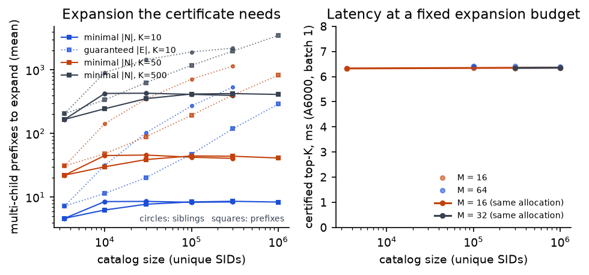

# Beam Search Is Optional: Certified, Late-Entry Decoding for LLM Generative Recommenders

*Working draft, 2026-11-08. Every number cites a run under `runs/` (GPU named in each table).
Sections marked [TBD] wait on runs that are queued.*

## Abstract

LLM-based generative recommenders emit an item as a short semantic-ID (SID) token sequence under a
catalog trie and serve it with constrained beam search. On an open, widely reproduced instance —
MiniOneRec (Qwen2-1.5B, three-level SIDs) on its two released datasets — we replace beam search with
**certified exact decoding**: one tree-attention forward over the prompt and every first-level trie
node bounds every catalog item (all scored terms are log-probabilities ≤ 0), a second forward over the
best-bounded prefixes yields exact scores, and an on-device test certifies that the returned top-K is
the global optimum of the model's objective (0 violations against brute force; 100% of requests
certified). The certificate itself is classical (exact n-best search, Fagin's threshold algorithm) and
was recently stated for generative recommendation as a post-hoc beam completion; we make it the decoder
and show what makes it cheap. Under **trie normalization** the bounds are two-sided — the best child of a
prefix with n children scores at least −log n — so the set of prefixes to expand is known, and
certification guaranteed, right after the first forward; that set averages ≤ 1.1·K prefixes at every K
up to 500 and is within 1.2–2.1× of the provable minimum for any bound-based decoder. On synthetic catalogs of up to 1M SIDs on the
same model, the minimal expansion stays flat (≈8 prefixes for a certified top-10) and so does latency at a fixed
budget. We further find that
**deeper SID codes do not need the lower layers**: prefix rows *enter* the second forward at layer 26 of
28 (first-level rows at layer 18) from small bridges distilled from the parent node's state on the
frozen model (validation prompts only, no labels), losslessly against the full-depth model
(ΔHR@10 +0.12 [−0.27, +0.51], ΔNDCG@10 0.00 [−0.20, +0.20]). With a hand-written engine (one CUDA graph
per request), a certified top-10 takes **2.75 ms on an H100** (MiniOneRec's beam-50 in the same engine and
allocation: 8.43 ms; Hugging Face `generate`: 869 ms on an A6000), and a certified top-500 2.92 ms (beam-500:
18.1 ms). Exact search also makes **objective fusion exact**:
adding a per-user collaborative term (β·log q from a 1-minute SASRec, itself computed inside the same CUDA graph:
2.89 ms end to end) inside the certified search keeps
two forwards and 100% certification and raises Office HR@10 from 0.1714 to **0.1825** (+1.11 [+0.62, +1.60];
+2.36 points over MiniOneRec's FP32 beam decode of the same checkpoint, with no LLM training) and HR@500 by
**4.0 points**, where beam-then-rerank cannot change the candidate set; Industrial gains +0.51 [+0.07,
+0.95]. With random item values, beam-then-rerank recovers only 50% of the exact top-10. One more
epoch of supervised fine-tuning adds +0.8 HR@10 (+2.0 HR@50) to the released checkpoint — but matching the
training loss to the decoder's normalization adds nothing beyond a full-vocabulary control.
Dynamic per-token FP8 is quality-neutral and adds 16–21% throughput; custom weight-streaming GEMMs, a
one-forward variant with in-flight prefix selection, and weight-only INT8 do not help at these shapes.

## 1. Introduction

Generative retrieval with semantic IDs is deployed at scale (OneRec, GR4AD, GRACE, PinRec,
Spotify, NVIDIA SID-GR) and serving cost gates its use. Public engines report throughput against
SGLang/vLLM/TensorRT-LLM with *approximate* parity (FlashRec: 86–92% beam-set overlap; NVIDIA:
top-K overlap 0.96) and make silent, different scoring choices (full-vocabulary log-softmax then
mask; per-codebook softmax; mask-before-softmax; `ignore_eos`). We ask, on one fully reproducible
model family with two datasets:

1. Where does the time go at batch 1, and what is the floor?
2. Is beam search necessary when the catalog trie is small?
3. Which score is being maximized, and does maximizing it exactly help?

Contributions:
- **Certified exact top-K decoding as the decoder** (not a post-hoc check): two forwards, a per-request
  optimality certificate computed on device, 100% of requests certified, validated against brute force.
- **Two-sided bounds under trie normalization**: the expansion set that guarantees the certificate is
  computed after the first forward; it averages ≤ 1.1·K prefixes at every K and is within 1.2–2.1× of the
  instance-optimal set (Props. 2–3). Codebook or full-vocabulary normalization admits no such bound.
- **Catalog scaling**: on denser synthetic catalogs (10k–1M SIDs) scored by the real model, the minimal
  expansion set is flat in catalog size (|N| ≈ 8.4 / 42 / 410 for K = 10 / 50 / 500) and certified top-10 latency
  at M = 16 is unchanged (6.34–6.38 ms on an A6000); the two-sided guarantee loosens with branching.
- **Late entry**: deeper SID codes skip the lower layers via bridges distilled from the parent node's
  state at the same depth (frozen model, no labels); the third code needs only the top 2 of 28 layers
  and the second the top 10, losslessly against the full-depth model on both datasets.
- **Exact search under fused objectives**: any additive item term (prior, bid, collaborative score)
  keeps the certificate with a per-prefix max bound. A SASRec term gives +1.11 HR@10 / +4.0 HR@500 on
  Office and +0.51 HR@10 on Industrial at ~3 ms, beating beam-then-rerank wherever the term moves items
  outside the LLM's own top list.
- **Engine and ladders** (A6000, H100) with a fidelity gate at every rung; batch-1 certified top-10 in
  2.75 ms on an H100 (2.89 ms with the fused SASRec term, SASRec computed in the graph), certified top-500
  in 2.92 ms (3.08 ms fused, SASRec included).
- **Model branch (mostly negative)**: one more SFT epoch helps the released checkpoint (+0.8 HR@10,
  +2.0 HR@50; with the SASRec term HR@10 0.1852), but a loss aligned with the decoder's restricted
  normalization is no better than full-vocabulary CE (ΔHR@10 +0.14 [−0.16, +0.47]).
- **Exact search as an instrument** (exhaustive FP32 scores, both datasets): the beam-search curse grows
  with list length; the decode-time scoring rule is a first-order, dataset-dependent choice.
- Negative results: one forward is not enough (user-independent third-code tables, speculation, and
  in-flight prefix selection with a tuned lens all fail to cover the certificate set); late entry of
  the *second* code below layer 18 is a trade-off; custom weight-streaming GEMMs lose to cuBLAS at ≥ 64
  rows; weight-only INT8/INT4 and static FP8 do not help (dynamic FP8 is neutral, +16–21% throughput).

**Headline (Office, H100, batch 1, one allocation, median of 2×500 requests; quality on all 4,866 test
users; `runs/finalH`).**

| decoder | ms | p95 | HR@10 | NDCG@10 | certified top-10 |
|---|---:|---:|---:|---:|---:|
| MiniOneRec beam-50 semantics, our FP16 engine | 8.43 | 8.57 | 0.1587* | — | — |
| certified exact, trie M=16, cbtrie 0.75 (full depth) | 4.35 | 4.53 | 0.1677 | 0.1304 | 100% |
| + both bridges (first level at 18, third code at 22) | 2.93 | 3.05 | 0.1712 | 0.1319 | 100% |
| third code at 26 (top 2 of 28 layers) | 2.75 | 3.00 | 0.1689 | 0.1304 | 100% |
| + SASRec term inside the certified search (β = 0.5), SASRec computed in the graph† | **2.89** | 2.97 | **0.1825** | **0.1388** | 100% |
| certified top-500 with fusion (SASRec in the graph)† | 3.08 | 3.16 | — | — | top-500: 100% |
| throughput, FP8 dynamic + fusion, B = 128 | 3,155 users/s | | 0.1819 | 0.1382 | 100% |

**Industrial (H100, `runs/finalIH`):** beam-50 semantics 8.37 ms (HR@10 0.1582) → certified 4.08 → both
bridges at layer 18 3.11 ms (0.1619) → + SASRec term 3.45 ms (**0.1670**, NDCG@10 0.1220; 3.09 ms with
SASRec in the graph in a later allocation, `runs/collabI`); certified fused top-500 for 100% of users at M = 512
in 4.23 ms; FP8 + fusion
3,738 users/s at B = 128. **A6000 (Office, `runs/finalA`):** beam-50 semantics 22.4 ms → certified 11.4 → both
bridges (third code at 26) 6.38 → + SASRec term 6.44 ms (HR@10 0.1825); HF `generate` FP32 868.8 ms.
**Fine-tuned backbone (one more SFT epoch, own bridges at 18/22, SASRec β = 0.3):** Office HR@10 0.1854 (+1.77
[+1.07, +2.45] over the released checkpoint at full depth; +0.27 n.s. over the released checkpoint with fusion).

†`runs/collabO` (one allocation): the per-request input is the 20-item history and SASRec (2 layers, d = 64)
runs on a side stream inside the graph; with SASRec rows precomputed per user and copied in (the earlier
setting), the same allocation measures 2.66 ms (top-500: 2.92 ms in `runs/finalH`). Quality is identical
(paired ΔHR@10 0.00; 99.0% of users get the same top-10 set, the rest FP16 near-ties). On Industrial the side stream
hides SASRec completely (3.09 vs 3.07 ms, `runs/collabI`).
\*MiniOneRec FP32 reference decode: 0.1589. Quality rows for the bridge configurations come from the
matching quality runs (`runs/casH`, `runs/e26H`, `runs/baseEV`).

## 2. Setting

**Model and data.** MiniOneRec Office checkpoint (Qwen2-1.5B: 28 layers, d=1536, 12/2 GQA
heads, tied 152,265-row embedding incl. 600 SID tokens). Items: 3,459 (3,444 unique SIDs;
15 two-item collisions) with a 3-level code ⟨a,b,c⟩. Trie: 88 first codes, 2,488 two-code
prefixes, max branching 66 / 12. Test users: 4,866; prompts 76–121 tokens. Latency cohort:
the frozen 500 distinct users of prior RapidTinyRec work.

**Released decoding.** Constrained beam search, width 50; each step adds the full-vocabulary
log-softmax of the allowed token; after `c` the trie forces `\n` then EOS and both are scored;
length penalty 0. Score(item) = lp(a)+lp(b|a)+lp(c|ab)+lp(\n|abc)+lp(EOS|abc\n).

**Metrics.** SID-level HR@K and NDCG@K on all 4,866 test users; paired bootstrap (2,000
resamples over users) for every quality delta. Latency: batch 1, CUDA-synchronized, one graph
replay per request; setup/compilation/capture excluded; median and p95 over 500 users.

## 3. Cost model

A forward reads ~3.1 GB of BF16 weights (1.31 B non-embedding parameters + the tied 0.47 GB
LM head). At 768 GB/s an A6000 needs ≥4.0 ms per forward regardless of how many query tokens
it carries until arithmetic dominates (~150–200 tokens for 155 dense BF16 TFLOPS). Beam-50
issues 5 sequential forwards (prompt; inputs a, b, c, \n), so its floor is ≈20–23 ms in BF16
and ≈40–45 ms in FP32, and its cost barely depends on the beam width. The levers are
therefore (i) fewer sequential forwards, (ii) fewer bytes per forward, (iii) fewer and fused
kernels per forward. [Roofline measurement: TBD `sweepH/roofline_*`.]

Profile of the first engine version (BF16, eager): ≈24 ms GEMM at ≈65% of peak bandwidth,
≈14 ms in ≈4,000 small elementwise kernels, ≈3–4 ms in the 152k-row LM head.

Two refinements from the final engine. (i) On the A6000 the fused first forward is
*compute*-bound: its GEMMs take 4.84 / 5.78 / 6.58 / 7.19 ms per forward at 16 / 64 / 140 / 216 rows
(cuBLAS; a tuned split-K Triton kernel helps only at ≤64 rows), and at 140 rows the gate/up GEMM
already runs at ≈57 TFLOPS. Fewer rows, not better kernels, is the lever there. (ii) On the H100
the engine is *kernel-count*-bound: the first certified decoder issued 2,555 kernels and 5.9 ms of GPU
time per request, with GEMMs at ≈50% of HBM bandwidth (≈3.1 ms) and ≈2.8 ms of small copy,
concatenation and attention-preparation kernels; streaming the weights twice would take ≈1.6 ms.
Late entry (fewer layers in the second forward) and a Triton prompt attention (fewer kernels in the
first) cut this to 1,474 kernels and 3.7 ms.

## 4. Engine

- **Hand-written forward** from safetensors: concatenated QKV and gate/up projections,
  vocabulary padded to 128 rows (aligned cuBLAS kernels), RMSNorm/RoPE as in HF Qwen2; Q is
  pre-scaled so FP16 does not overflow on Qwen2's large QKV biases.
- **Shared-prefix KV layout**: one copy of the prompt K/V per user; ≤4 private K/V slots per
  beam row; reorder only the private slots.
- **Fused forced suffix**: score `\n` and EOS with one two-token forward per beam (exact: each
  final beam has a single admissible continuation, so nothing is pruned). −10 ms.
- **Trie-level prefill fusion** (`prefill_tree`): append the |A| first-level trie nodes to the
  prompt; node i attends to the user's prompt and itself at position L. One forward yields
  lp(a) and lp(b|a) for every a. Rank-identical to the unfused engine (FP32 score Δ ≤ 3e-5).
- **Triton shared-prefix beam attention**: one program per (user, row, KV head) packs all query
  heads of the group and all new tokens of the row against the prompt K/V and the private
  slots with a causal rule; fp32 softmax. 2× closer to FP32 than the PyTorch BF16 path.
- **One CUDA graph per (batch, padded length)** with a shared memory pool; torch.compile fuses
  the per-layer elementwise work.

- **Triton prompt attention for the fused first forward** (`--tree-fast`): the template K/V is
  copied into the cache once per request, prompt rows attend causally over the cache with a
  Triton kernel, trie-node rows reuse the shared-prefix beam kernel; no per-layer concat, K/V-head
  repetition or mask tensors. H100: 5.47 → 4.56 ms for the certified top-10 decoder, identical
  quality.
- **Cached prompt template**: all MiniOneRec prompts share a 69-token instruction prefix; its K/V
  are computed once, so the fused first forward carries only the user-specific tail plus the
  first-level trie nodes (bit-identical outputs in FP32).

Ladder (`runs/ladder2`: one allocation, one RTX A6000, 2 × 500 requests per rung; batch 1; median /
p95 ms; HF and prior rows from earlier RapidTinyRec measurements on the same GPU type and cohort):

| rung | median | p95 | fidelity / quality |
|---|---:|---:|---|
| HF `generate`, FP32 | 868.8 | — | reference |
| RapidTinyRec FP32 bit-exact stack (prior) | 114.8 | 119.9 | bit-exact |
| RapidTinyRec BF16 (prior) | 56.5 | 57.6 | HR@10 = reference |
| speedrun engine, FP32 | 100.8 | 105.5 | top-10 set = reference for 500/500 |
| BF16, one CUDA graph per request (fused suffix) | 42.1 | 42.9 | top-1 = FP32 471/500 |
| + torch.compile | 35.0 | 35.4 | |
| + trie-level prefill fusion + Triton beam attention | 28.1 | 28.4 | HR@10 = FP32 (0.1589) |
| + FP16 + cached template | 26.2 | 27.7 | top-1 = FP32 500/500 |
| certified exact, trie scoring | **14.4** | 15.7 | top-50 certified 99.9%; HR@10 0.1648 |
| certified exact, codebook, w_c = 0.5 (tuned on validation) | **14.4** | 15.6 | top-10 certified 99.7%; HR@10 0.1700 |
| certified exact, trie, multi-child prefixes only (M=16) + Triton prompt attention (`runs/finA`) | 13.25 | 14.40 | top-10 certified 100%; HR@10 0.1652 |
| + late entry for the third code (bridge at layer 22, trained on validation) | **8.98** | 10.23 | HR@10 0.1669; top-10 certified 100% |

Same ladder on an H100 (`runs/h100M`, one allocation, 2 × 500 requests per rung):

| rung (H100) | median | p95 | fidelity / quality |
|---|---:|---:|---|
| speedrun engine, FP32 | 48.3 | 50.2 | top-10 set = reference 500/500 |
| BF16, one CUDA graph | 20.1 | 22.4 | top-1 = FP32 465/500 |
| + torch.compile | 12.9 | 13.0 | |
| + trie-level prefill fusion + Triton beam attention | 8.50 | 8.66 | top-1 = FP32 491/500 |
| + FP16 + cached template | 8.48 | 8.59 | top-1 = FP32 500/500 |
| certified exact, trie | **5.57** | 5.74 | top-50 certified 100% (cohort) |
| certified exact, codebook w_c = 0.5 | **5.66** | 5.76 | HR@10 0.1697 (full test) |
| certified exact, trie, M=16 + Triton prompt attention + whole-layer compile + fused K/V stores (`runs/finH`) | 4.37 | 4.52 | HR@10 0.1652 |
| + late entry for the third code (layer 22) | **3.32** | 3.44 | HR@10 0.1669 (3.16 ms in `runs/storeH`) |

On the H100 the engine is kernel-bound rather than bandwidth-bound: 2,555 kernels and 5.9 ms
of GPU time per request, of which GEMMs are ≈3.1 ms (≈50% of HBM bandwidth) and small
copy/concat/attention-prep kernels ≈2.8 ms; streaming the weights twice would take ≈1.6 ms.
Compiling whole decode layers (incl. the Triton attention) saves 3.5% here (5.15 vs 5.33 ms in a
paired run) but nothing on the A6000. FP8 W8A8 is slower on the H100 too (6.0 ms).

The separate-suffix variant (two one-token forwards for `\n` and EOS) costs 55.9 vs 46.3 ms in the
earlier paired ladder (`runs/ladderZ`), i.e. forced-suffix fusion saves ≈10 ms. Allocations of the
same GPU type differ by up to ≈10% in absolute latency; ratios are taken within one allocation.

## 5. Certified exact decoding

```
input : prompt x, catalog trie (first codes A, prefixes (a,b), items (a,b,c)), budgets M, N, K
F1    : one forward over [x ; every a ∈ A as a tree node]          # trie-level prefill fusion
        s(a) for all a ;  s(b|a) for all valid (a,b)
        U2(a,b) = s(a) + s(b|a)                                        # admissible: score ≤ U2
F2    : one forward over the M prefixes with largest U2, token b each, reusing the a-node K/V
        s(c|ab) for all children ;  U3(a,b,c) = U2 + s(c|ab)            # exact if no forced suffix
F3    : (forced suffix only) one forward over the N items with largest U3, tokens [c, \n]
        exact(a,b,c) = U3 + s(\n|abc) + s(EOS|abc\n)
return: items sorted by exact score, and for each K:
        certified_K = exact_(K) ≥ max( U3 of best un-suffixed item , U2 of best unexpanded prefix )
```
Every step has a fixed shape (|A|, M, N), so the whole request is one CUDA-graph replay; the
certificate is computed on the device and returned with the list.

All scored terms are log-probabilities ≤ 0. Define U2(a,b) = s(a)+s(b|a) and
U3(a,b,c) = U2 + s(c|ab). For any item, score ≤ U3 ≤ U2.

1. **F1** (fused prefill): prompt + all first codes → s(a) ∀a, s(b|a) ∀(a,b) ⇒ U2 for all items.
2. **F2**: the M best prefixes by U2, one token (b) each, reusing the a-node K/V → s(c|ab) for
   all their children ⇒ U3 (exact when there is no forced suffix).
3. **F3** (only with the forced suffix): the N best items by U3, tokens [c, \n] → exact scores.
4. **Certificate**: top-K is globally optimal iff the K-th exact score ≥ max(U3 of the best
   un-suffixed item, U2 of the best unexpanded prefix).

Validated against brute-force scoring of all 3,444 SIDs in FP32: 0 violations among certified
users; top-1 always optimal.

Certification rate (share of the 4,866 Office test users whose top-K is proven globally optimal):

| decoder | scoring | forwards | top-1 | top-5 | top-10 | top-20 | median ms |
|---|---|---:|---:|---:|---:|---:|---:|
| single bound, N=16 items | full (with suffix) | 3 | 0.88 | 0.11 | 0.00 | — | 31.1* |
| single bound, N=32 | full | 3 | 0.96 | 0.32 | 0.05 | 0.00 | 32.4* |
| single bound, N=64 | full | 3 | 0.98 | 0.58 | 0.27 | 0.03 | 36.6* |
| single bound, N=128 | full | 3 | 0.99 | 0.75 | 0.54 | — | 45.5* |
| single bound, N=64 | no suffix | 3 | 1.00 | 0.94 | 0.83 | 0.26 | 31.5* |
| three-stage, M=64, fused first level | no suffix | 2 | 1.00 | 0.97 | 0.94 | 0.86 | 19.8 |
| three-stage, M=64, fused first level | trie | 2 | 1.00 | 1.00 | 1.00 | 1.00 | 16.1 |

\*uncompiled, unfused first level, PyTorch attention (earlier engine stage).

Skipping the second forward when the certificate already closes after the first (possible under
trie scoring, where single-child prefixes — 1,907 of 2,488 — have exact scores after F1)
happens for 42% of users at K=1 but only 0.4% at K=10, so the second forward stays.

### 5.1 What the certificate costs, as a function of K

The second forward must expand every prefix whose bound exceeds the K-th exact score,
{(a,b) : U2(a,b) > s_K}. From the exhaustive FP32 scores (all test users, both datasets):

| prefixes to expand (median / p90 / p99) | K=10 | K=50 | K=100 | K=500 | K=1000 |
|---|---|---|---|---|---|
| Office, trie | 10 / 12 / 14 | 52 / 57 / 61 | 104 / 111 / 117 | 489 / 510 / 524 | 932 / 960 / 979 |
| Office, codebook w_c=0.5 | 10 / 13 / 35 | 51 / 61 / 180 | 100 / 117 / 325 | 459 / 517 / 1,058 | 871 / 962 / 1,600 |
| Office, full vocabulary (MiniOneRec) | 52 / 1,715 / 2,488 | 268 / 2,462 / 2,488 | 506 / 2,486 / 2,488 | — | — |
| Industrial, trie | 10 / 13 / 16 | 52 / 60 / 65 | 103 / 115 / 123 | 470 / 501 / 522 | 881 / 922 / 948 |

Under trie normalization the bound is almost tight: certifying the top K costs about K prefix
expansions at every K, with a thin tail. Under the full-vocabulary objective the off-codebook
leak and the suffix make U2 loose and certification needs nearly the whole trie. The
normalization choice therefore decides whether exact search is affordable at all.

Trie normalization gives a second saving. The third-code term is a log-softmax over the valid
children of (a,b), so it is exactly 0 when (a,b) has one child: every item under a single-child
prefix is exactly scored by the first forward. Only multi-child prefixes need the second
forward (Office: 581 of 2,488 prefixes, holding 1,537 of 3,444 items):

| multi-child prefixes to expand (median / p90 / p99) | K=10 | K=50 | K=100 | K=500 |
|---|---|---|---|---|
| Office, trie | 5 / 8 / 10 | 22 / 31 / 38 | 43 / 55 / 64 | 175 / 198 / 213 |
| Industrial, trie | 6 / 9 / 12 | 29 / 37 / 43 | 53 / 65 / 75 | 205 / 238 / 259 |

`ExactTrieEngine` expands only multi-child prefixes; its candidate pool is the expanded children
plus every single-child item, both exact. It reproduces the three-stage engine rank-for-rank and
score-for-score (FP32). A certified top-500 is still two forwards, the second carrying ≈210
rows; beam-500 needs four forwards of 500 rows each (three with trie scoring).

**One forward is not enough.** Two ways to drop the second forward fail:
- *A user-independent third-code table* (per-item mean of s(c|ab) over validation users) keeps
  HR@10 within 0.9 pt but drops HR@1 from 0.098 to 0.050 (−4.8 pt [−5.5, −4.1]). Item identity
  explains 77% of the variance of s(c|ab) overall but only 42% within a user's top-50; the third
  code orders siblings per user.
- *Speculating the expansion set before the first forward* (from the user's previous request,
  history prefixes or popularity) covers the full certificate set for top-10 in at most 29% of
  requests with 128 guessed prefixes; certification needs the near-boundary prefixes too.
Certification after the first forward alone happens for 44% of users at K=1 and 0.5% at K=10.

### 5.1b Two-sided bounds: the expansion set is known after the first forward

Upper bounds alone say which prefixes *might* hold a top-K item. Trie normalization also gives a
**lower bound**: the third-code term is a log-softmax over the n_p valid children of p = (a,b), so its
largest child has log-prob ≥ −log n_p, and some item under p scores at least L(p) = U(p) − w_c log n_p
(U(p) = s(a) + w_b s(b|a), exact after forward 1). Single-child items are exactly scored by forward 1.

- **Prop. 1 (soundness; known).** If the K-th exact pool score ≥ U of every unexpanded prefix, the pool's
  top K is the global top K (all terms ≤ 0). [Stahlberg & Byrne 2019; Stahlberg et al. 2022; Fagin's TA;
  stated for GR as post-hoc beam completion in Beyond the Beam, 2609.33745.]
- **Prop. 2 (necessity / instance optimality).** Let τ* be the true K-th score. Any algorithm whose only
  information about an unexpanded prefix is U(p) must expand every multi-child p with U(p) > τ*: the
  children's log-softmax can put its mass on one child scoring U(p) − ε > τ*, which would enter the top K.
  So N = {p : U(p) > τ*} is a lower bound for every bound-based decoder, and best-first expansion by U
  reaches it (up to ties).
- **Prop. 3 (guaranteed expansion set).** Let τ_L be the K-th largest value of {exact single-child scores}
  ∪ {L(p) : p multi-child}. K distinct items score ≥ τ_L, so τ_L ≤ τ*. Expanding
  E = {p multi-child : U(p) ≥ τ_L} ⊇ N always certifies: the pool then contains those K items, and every
  unexpanded prefix has U < τ_L. |E| is computed on device right after forward 1; E \ N contains only
  prefixes with τ_L ≤ U < τ*, a band of width ≤ τ* − τ_L ≤ w_c log n_max.
- Codebook or full-vocabulary normalization of the last level admits no such lower bound (the valid
  children can hold arbitrarily little mass), so this is a property of trie normalization only.

Measured on all test users (`scripts/lbound.py`, `runs/lbndA`; |E| mean / p99 / max vs the minimal |N|
mean / max):

| K | Office (cascade late entry, cbtrie 0.75) | Office (trie, full depth) | Industrial (cbtrie 0.75) |
|---|---|---|---|
| 1 | 0.8 / 4 / 8 vs 0.6 / 3 | 0.8 / 4 / 13 vs 0.6 / 5 | 1.0 / 5 / 9 vs 0.7 / 4 |
| 10 | 6.7 / 16 / 24 vs 4.5 / 13 | 7.0 / 18 / 26 vs 4.9 / 13 | 10.6 / 23 / 29 vs 5.0 / 14 |
| 50 | 29.7 / 50 / 62 vs 21.7 / 43 | 30.4 / 53 / 62 vs 22.7 / 44 | 41.5 / 62 / 75 vs 25.1 / 45 |
| 100 | 54.6 / 83 / 99 vs 41.5 / 71 | 55.7 / 86 / 101 vs 43.2 / 80 | 72.7 / 102 / 116 vs 47.9 / 81 |
| 500 | 203 / 248 / 267 vs 166 / 220 | 206 / 255 / 276 vs 172 / 225 | 259 / 318 / 342 vs 188 / 256 |

The guaranteed set is ≤ 1.1 K prefixes on average at every K (0.41 K at K=500) and 1.2–2.1× the provable
minimum. In serving terms: forward 2 is a fixed-shape graph with M rows; with M ≥ max |E| (Office top-10:
24) certification is guaranteed before forward 2 runs, and an overflow (|E| > M) is detected after
forward 1 rather than discovered after forward 2. Our M=16 configuration covers |E| for 99% of Office
users and still certifies 100% because E over-approximates N.

### 5.1c Catalog scaling: the expansion the certificate needs does not grow with the catalog

The released catalogs are small (3,444 SIDs), but the model's vocabulary addresses 88 × 256 × 256 = 5.8M SIDs, so we
densify the trie and run the real model on real prompts (`scripts/scale_catalog.py`, 500 Office test users,
cascade late entry, cbtrie 0.75). Quality is meaningless on synthetic items; cost and certification are not.
*siblings* adds third codes under the 2,488 real (a, b) prefixes (10k–300k SIDs, up to 145 children per prefix);
*prefixes* adds new (b, c) under the 88 real first codes, with codes drawn from the real per-level frequencies
(10k–1M SIDs, up to 22,488 prefixes and 215 children). |N| is the minimal set any bound-based decoder must expand
(Prop. 2), |E| the guaranteed set (Prop. 3); certification is that of the deployed engine at budget M.

| catalog | SIDs | prefixes (max children) | \|N\| K=10 / 50 / 500 | \|E\| K=10 | top-10 cert. M=16 / 32 | top-50 cert. M=64 / 128 | A6000 ms, M=16 / 64 |
|---|---:|---:|---|---:|---|---|---|
| real | 3,444 | 2,488 (12) | 4.7 / 22 / 167 | 7.3 | 100 / 100% | 100 / 100% | 6.33 / — |
| siblings | 100k | 2,488 (60) | 8.3 / 42 / 412 | 272 | 100 / 100% | 99.6 / 100% | 6.34 / 6.41 |
| siblings | 300k | 2,488 (145) | 8.4 / 41 / 396 | 537 | 99.8 / 100% | 98.2 / 100% | 6.34 / 6.42 |
| prefixes | 100k | 19,853 (45) | 8.4 / 45 / 417 | 48 | 100 / 100% | 100 / 100% | 6.35 / 6.41 |
| prefixes | 1M | 22,488 (215) | 8.4 / 41 / 411 | 290 | 99.6 / 100% | 99.2 / 100% | 6.36 / 6.40 |

- **The minimal expansion is flat in catalog size**: |N| ≈ 8.4 / 42 / 410 for K = 10 / 50 / 500 from 10k to 1M
  SIDs (all sizes in `research/scale_catalog_office.json`). It is smaller on the real catalog only because 1,907
  of its 2,488 prefixes have a single child and are exact after forward 1.
- **So is the latency at a fixed budget**: in one allocation (`runs/scaleP`, 2×500 requests each) the real
  catalog takes 6.33 / 6.32 ms (run before and after) and the 1M-SID catalog 6.36 ms at M = 16 and 6.36 ms at
  M = 32 (+0.5%); siblings-300k at M = 32 6.35 ms. Forward 1 carries the prompt and the 88 first-level rows whatever the
  catalog (the second code is a restricted LM head over ≤ 256 codes), forward 2 carries M rows, and the third-code
  head has ≤ 256 columns. Certified top-10 at M = 16 holds for ≥ 99.6% of users at every size and at M = 32 for
  100%; top-50 needs M = 64 (≥ 98.2%) or 128 (100%); top-500 needs M ≥ 512 on the dense catalogs (|N| ≈ 410;
  83–100% certified at M = 512).
- **The two-sided guarantee does not scale**: |E| grows with the number of children (K = 10: 7 → 290–537)
  because the −w_c log n lower bound loosens. The certificate itself uses the forward-2 scores and is unaffected,
  so on dense tries size forward 2 by a fixed M (with a fallback for the rare uncertified request), not by E.
- Caveat: synthetic items have no training signal of their own; the model scores them through their codes. A model
  trained on a 1M-item catalog may spread or sharpen its prefix distribution differently.



### 5.2 Late entry: the third code does not need the lower layers

The logit lens shows SID codes are decided in the last 6–9 of 28 layers, and early exit (running
only the *first* k layers for the third code) keeps HR@10 but loses 2.4–3.7 points of HR@1. We
instead let the prefix rows of the second forward *enter late*: a row (a,b) starts at layer e with
an input built from its parent node's residual stream at layer e — already computed for every
first code in forward 1 — and runs layers e..27 with exact attention to the prompt and parent
K/V. The input comes from a small bridge,

    x_e(a,b) = h_e(a) + R_e [h_e(a); E[b]; E[a]; 1] + MLP_e([rms(h_e(a)); E[b]; E[a]]),

where R_e is a ridge fit (label-free) and the MLP (2,048 hidden units, output zero-initialized)
is distilled from the model itself: KL between the full-depth and the late-entry third-code
distributions on MiniOneRec *validation* prompts, weighting each prefix row half uniformly and
half by the softmax of its bound U2 (the rows that decide the ranking). Training takes 1–2 minutes
on one H100; no item labels are used and the base model is frozen. The certificate holds for the
late-entry objective. At serving time the bridge runs in FP16 (two small GEMMs).

All test users, validation-tuned codebook objective (w_c = 0.5), FP16, paired against the
full-depth third code (Office HR@1 0.0980 / HR@10 0.1706 / NDCG@10 0.1312; Industrial 0.0847 /
0.1613 / 0.1181):

| second forward | layers | ΔHR@1 | ΔHR@10 | ΔNDCG@10 | top-1 = full |
|---|---:|---|---|---|---:|
| Office, early exit (first k layers) | 6 | −3.68 [−4.34, −3.08] | −0.84 [−1.29, −0.39] | −2.11 [−2.44, −1.77] | 53% |
| Office, late entry, ridge bridge | 6 | −0.51 [−0.86, −0.14] | −0.58 [−1.05, −0.14] | −0.54 [−0.80, −0.29] | 66% |
| Office, late entry, distilled bridge (uniform KL) | 6 | −0.12 [−0.37, +0.12] | −0.12 [−0.35, +0.08] | −0.08 [−0.22, +0.04] | 92% |
| **Office, late entry, distilled bridge (weighted KL)** | **6** | **+0.27 [+0.12, +0.45]** | **−0.04 [−0.25, +0.16]** | **+0.10 [−0.01, +0.20]** | **94%** |
| Office, distilled bridge (uniform) | 2 / 4 / 10 / 14 | −0.45 / −0.27 / +0.06 / −0.02 | −0.09 / +0.04 / — / +0.14 | −0.24 / −0.09 / −0.00 / +0.05 | 86–94% |
| Industrial, early exit | 10 | −2.38 [−2.96, −1.83] | −0.77 [−1.30, −0.20] | −1.80 [−2.18, −1.40] | 47% |
| Industrial, distilled bridge (uniform KL) | 10 | −0.35 [−0.62, −0.11] | −0.04 [−0.31, +0.20] | −0.18 [−0.33, −0.04] | 86% |
| **Industrial, distilled bridge (weighted KL)** | **10** | **−0.07 [−0.22, +0.09]** | **−0.04 [−0.24, +0.18]** | **−0.04 [−0.13, +0.05]** | **92%** |

With prefix-weighted distillation, late entry is statistically indistinguishable from the
full-depth second forward on HR@10 and NDCG@10 on both datasets (Office at 6 remaining layers,
Industrial at 10), and stays above the MiniOneRec reference decode (Office HR@10 0.1702 vs
0.1589). The small HR@1 gain on Office is a calibration side effect of the bridged objective, not
a claim we rely on. Late entry of the *second* code (the 88 first-code rows joining forward 1 at
layer 22, bridged from the last prompt token) is a trade-off: ΔNDCG@10 −0.25 [−0.51, −0.01], and
only 61% of top-10 prefixes agree with full depth; the second code decides set membership.

Engine latency (CUDA graph, FP16, paired within one allocation; certified top-10):

| | A6000 | H100 |
|---|---:|---:|
| certified exact, trie, M=16 | 13.65 | 5.03–5.47 |
| + Triton prompt attention in forward 1 | 13.26 | 4.56 |
| + late entry at layer 22 | **9.06** | 3.56 |
| + whole-layer compile, FP16 bridge | 9.07 | **3.24** |
| certified exact, tuned codebook, M=64 → + late entry 22 | 14.33 → 9.68 | 5.57 → 4.17 |
| certified top-500 → + late entry + fast forward 1 | 17.95 → 10.09 | 6.06 → 3.36 |

Industrial & Scientific (all 4,533 test users; paired against our fastest FP16 engine running MiniOneRec's
own beam-50 on the same GPU): MiniOneRec beam 25.75 ms (A6000) / 8.37 ms (H100), HR@10 0.1582; certified
trie 12.89 / 4.23 ms, HR@10 0.1588; **+ late entry at layer 18: 9.40 / 3.22 ms, HR@10 0.1597** (ΔHR@10
+0.18 [−0.38, +0.71], ΔNDCG@10 −0.08 [−0.36, +0.20], ΔHR@1 −0.29 [−0.64, +0.07]) — quality-neutral at
2.7× / 2.6× the speed.

## 6. What exact decoding reveals about the objective

**Beam search error is real but is not what limits quality.** From exhaustive FP32 scores of every
catalog SID for every test user (`scripts/dump_scores.py`), beam-50 under MiniOneRec's
full-vocabulary objective recovers 86% of the exact top-10 (top-1 exact for 99.8% of users), yet
exhaustive search gives the same HR@10. Under codebook or trie normalization beam-50 is
essentially exact (99.6% / 99.9% of the exact top-10).

**The beam-search curse grows with list length.** Generative retrieval feeds hundreds of
candidates to a ranker, so lists longer than 10 matter. Beam-W recovers only part of the exact
top-W under the full objective (Office 49% at W=50, 53% at 100, 64% at 500; Industrial 67 / 69 /
79%); under trie scoring 95 / 96 / 99.6%. Under the full objective, exact search *loses* recall
and the loss grows with K (Office, paired bootstrap vs MiniOneRec's beam-W decode): HR@50 −1.8 pt
[−2.5, −1.1], HR@100 −2.5 [−3.3, −1.7], HR@200 −3.5 [−4.4, −2.5], HR@500 −4.3 [−5.3, −3.2];
Industrial −0.1 to −0.7 (n.s.). With the validation-tuned codebook objective exact search
*gains* recall on both datasets: Office HR@100 +2.3 [+1.5, +3.0], HR@500 +2.4 [+1.4, +3.3];
Industrial HR@200 +0.9 [+0.1, +1.6], HR@500 +0.9 [+0.0, +1.8]. Beam search's prefix-first pruning
acts as an implicit depth discount; once the discount is explicit, exactness stops hurting.

**The objective is mis-calibrated in its deep terms.** Three independent signals:
1. Admitting fewer candidates by prefix bound improves HR@10 (N=16: +0.70 pt [+0.12, +1.29] vs the
   FP32 reference); admitting more converges back to beam.
2. Dropping the forced newline/EOS terms improves NDCG@10 by +0.36 pt [+0.13, +0.61].
3. Restricted normalizations — what production engines do for speed — score better than the
   training objective (beam-50, full test set):

| scoring rule | HR@1 | HR@10 | NDCG@10 | HR@50 |
|---|---:|---:|---:|---:|
| full vocabulary, with forced suffix (MiniOneRec) | 0.0947 | 0.1589 | 0.1249 | 0.2370 |
| full vocabulary, no suffix | 0.0986 | 0.1624 | 0.1284 | 0.2363 |
| trie-renormalized | 0.0982 | 0.1648 | 0.1287 | 0.2417 |
| codebook-renormalized (FlashRec-style) | 0.0986 | 0.1667 | 0.1299 | 0.2470 |

**Depth-discounted scoring.** Weighting later SID levels less,
score = lp(a) + w_b lp(b|a) + w_c lp(c|ab) + w_s(lp(\n)+lp(EOS)), is a two/three-parameter
decode-time calibration that keeps every term ≤ 0, so certified exact decoding applies unchanged.
In-sample on a quarter of the Office test users, w = (0.75, 0.3, 0.3) raises HR@10 by ~10%
relative. [TBD: weights tuned on MiniOneRec's validation split, evaluated once on test, both
datasets — `scripts/tune_weights.py`.] Why the deep terms mislead (exhaustive FP32 scores, 1,217 Office users × 3,444 SIDs):
- **Sibling penalty.** lp(c|ab) falls with the number of catalog items sharing the prefix
  (a,b): median −0.87, −2.46, −3.05, −3.38, −4.12 for 1, 2, 3, 4, 6 siblings (Pearson r = −0.36
  between lp(c|ab) and sibling count over each user's top-50) — steeper than the −log k of an
  even split (−1.6 nats from one to two siblings vs log 2 = 0.69). This is a structural penalty
  on items that share a prefix, unrelated to the user (Fig. `sibling_penalty_office`).
- **Codebook leakage.** Even after a valid (a,b), a median 47% of next-token mass falls outside
  the c-codebook (median log-mass −0.63, flat across sibling counts); full-vocabulary scoring
  charges every item for it, unevenly across users and prefixes. Codebook/trie renormalization removes it.
- **The forced suffix is mixed evidence.** On average the target's lp(\n)+lp(EOS) is higher than
  its competitors' (−1.69 vs −6.31; competitor mean dominated by a few very unlikely completions),
  but adding the suffix moves the target up for 28% of users and down for 25%; it correlates
  with log item popularity (r = 0.15) — a weak popularity prior that costs a forward.
These are consistent with SID-MLP's observation that SID difficulty concentrates in the first
code: preference information lives in lp(a) and lp(b|a), while deeper terms are dominated by
catalog structure.

### 6.x Exact search under value-augmented objectives

Production rankers rarely serve the model's log-probability alone: they add item-level terms (priors,
bids, freshness, a collaborative model's opinion). With beam search such a term can only be applied
after the beam has pruned. Certified search handles any additive item term v_u(i) exactly: the bound of
prefix p becomes U(p) + max_{i under p} v_u(i) (a scatter-max per request), the expansion is still one
forward of M rows, and the certificate is unchanged (`set_item_bonus`; per-user terms are read from a
device buffer inside the CUDA graph).

*Search error of beam-then-rerank.* With a synthetic per-item value v ~ N(0,1) weighted by λ, "LLM top-50
then rerank" (an upper bound on any beam-50 + rerank pipeline) recovers 99.99 / 99.2 / 87.0 / **50.0%** of
the exact top-10 at λ = 0.25 / 0.5 / 1 / 2 (Office, 2,000 users); certified search stays 100% certified
at M = 32.

*Filters.* A filter (inventory, region, policy) is an item term of 0 or −∞; a prefix whose items are all
excluded gets bound −∞ and is never expanded. Certified search returns the exact top-K *eligible* items in
the same two forwards and certified 100% of users under every filter we tried. Filtering the LLM's own
top-50 afterwards recovers 99.6 / 92.8 / **30.5%** of the exact filtered top-10 at 50 / 20 / 5% random
eligibility (3 items survive at 5%), and 88.3 / 68.0% when only 25 / 10% of first codes are allowed; HR@10 at
5% eligibility drops from 0.029 to 0.018. Filtering a top-500 list recovers ≈99.7% (residual: FP16 near-ties
across batch shapes) — i.e. filter-after-retrieval needs a ~10× longer candidate list to match two
certified forwards (Office, 2,000 users, `runs/filtS`).

*Collaborative fusion.* A SASRec (2 layers, d = 64, train split, 58 s on one GPU; alone: test HR@10 0.1500, NDCG@10 0.1156) supplies
v_u(i) = β log q(i | history). β is chosen on validation (0.5). Office test, all 4,866 users:

| decoder (Office test) | HR@1 | HR@10 | NDCG@10 | HR@50 |
|---|---:|---:|---:|---:|
| LLM, certified (cbtrie 0.75, both bridges) | 0.0993 | 0.1714 | 0.1319 | 0.2513 |
| LLM top-50, then rerank with β log q (β = 0.5) | 0.1021 | 0.1800 | 0.1377 | 0.2513 |
| **certified exact, LLM + β log q** | **0.1025** | **0.1825** | **0.1391** | **0.2721** |

vs the LLM alone: ΔHR@10 +1.11 [+0.62, +1.60], ΔNDCG@10 +0.72 [+0.45, +1.00], ΔHR@50 +2.08 [+1.44, +2.69];
vs rerank: ΔHR@10 +0.25 [+0.08, +0.43], ΔNDCG@10 +0.13 [+0.04, +0.23]. Against MiniOneRec's FP32 beam decode
of the same checkpoint (0.1589) this is +2.36 points of HR@10 with no LLM training — on par with the best
*trained* result we found on the same split (DASO, 0.1834) and above S-GRec, V-STAR and SA-OPSD
(0.1689–0.1747). Industrial (`runs/fuseI`, β = 0.5): HR@10 0.1617 → 0.1668 (+0.51 [+0.07, +0.95]), NDCG@10
+0.42 [+0.19, +0.66], HR@50 +0.84 [+0.22, +1.48]. At large K the fused certified top-500 lifts HR@500 by 4.0
points on Office (0.504 → 0.543) and 2.1 on Industrial (0.523 → 0.544), where reranking the LLM's own top 500
cannot change the set; Industrial top-500 certifies for 83–85% of users at M = 256 under the fused objective
and for 100% at M = 512 (4.23 vs 3.50 ms, `runs/collabI`; Office: 100% at M = 256). End to end, with SASRec
computed inside the graph on a side stream from the user's 20-item history, the fused decoder takes 2.89 ms on
Office (2.66 ms with precomputed SASRec rows, same allocation) and 3.09 ms on Industrial (3.07 ms), at identical
quality; FP8 throughput with in-graph SASRec is 3,048 / 3,134 (Office) and 3,581 / 3,660 (Industrial) users/s at
B = 64 / 128. (A `torch.compile`d SASRec head was faster but returned wrong values inside the graph; not used.)

### 6.y Training the model the decoder sees

MiniOneRec is trained with full-vocabulary next-token cross-entropy, but our decoder ranks with
per-level log-softmax over restricted sets (codebook for the first two codes, valid trie children for
the third). We fine-tune the released checkpoint for one epoch on its own train split (38.9k rows,
lr 1e-5, AdamW, bf16 autocast, one A40, 17.5 min) with exactly that restricted per-level cross-entropy on
the three SID positions (`scripts/train_sft.py`). Same certified decoder, full depth, all test users:

| Office test (certified, cbtrie 0.75, full depth) | HR@1 | HR@10 | NDCG@10 | HR@50 |
|---|---:|---:|---:|---:|
| released checkpoint | 0.0988 | 0.1677 | 0.1304 | 0.2446 |
| + 1 epoch, decoder-aligned restricted CE | 0.0991 | 0.1767 | 0.1345 | 0.2643 |
| + 1 epoch, full-vocabulary CE (control) | 0.0978 | 0.1753 | 0.1337 | 0.2643 |
| aligned fine-tune + SASRec term (β = 0.3) | 0.1011 | **0.1852** | 0.1388 | 0.2797 |

Aligned vs released: ΔHR@10 +0.90 [+0.27, +1.54], ΔNDCG@10 +0.41 [+0.04, +0.78], ΔHR@50 +1.97 [+1.15, +2.77]
(validation ΔHR@10 +1.27). **But the control gets almost all of it:** aligned vs full-vocabulary CE ΔHR@10
+0.14 [−0.16, +0.47], ΔNDCG@10 +0.08 [−0.07, +0.24], ΔHR@50 0.00 (validation ΔHR@10 −0.14). One more SFT epoch
helps the released checkpoint; matching the training normalization to the decoder's does not measurably
add to it — a negative result for the "align training with decoding" hypothesis. Bridges trained on the released model transfer imperfectly (entry 22: HR@10
0.1743), so a fine-tuned backbone needs its own bridges (~25 min). [Industrial replication and a second
seed: Industrial ΔHR@10 +0.49 [−0.15, +1.13] (n.s.), ΔHR@50 +1.81 [+0.95, +2.65]; a second Office seed
reproduces ΔHR@10 +0.86 [+0.21, +1.54].]

## 7. Precision and quantization

| precision (fused + Triton beam, full semantics) | ms | top-1 = FP32 | top-10 set = FP32 | identical 50-lists | max \|Δscore\| |
|---|---:|---:|---:|---:|---:|
| FP32 (TF32 off) | 98.8–105.0 | 500/500 | 500/500 | — | — |
| FP16 (Q pre-scaled) | 27.5 | 500/500 | 484/500 | 151/500 | 0.15 |
| BF16 | 27.9 | 488/500 | 374/500 | 0/500 | 1.48 |

FP16 is as fast as BF16 and ~10× more faithful; HR/NDCG are statistically indistinguishable
from FP32 for both. Weight-only INT8 (GemLite) is quality-neutral but only 3–8% faster;
INT4 (RTN, group 128) is no faster and less faithful. The kernel profile explains why: after
fusion, GEMMs are ≈80% of GPU time at ≈75% of peak bandwidth, with M = 50–216 rows per forward
— outside the M ≤ 16 regime where weight-only kernels shine. The roofline makes this explicit: one
A6000 forward costs 8.1 / 9.8 / 12.2 / 16.1 ms at 1 / 50 / 128 / 256 tokens in BF16, versus 5.2 / 8.3 /
11.8 / 18.1 ms with INT8 weights. On an L40S, dynamic per-token FP8 W8A8 (`torch._scaled_mm`,
rowwise scales) is *slower* than BF16 end to end (certified exact 15.9 vs 14.0 ms; beam 23.5 vs
20.1 ms) at near-equal quality, because quantizing activations at every GEMM outweighs the
narrower weights at 50–216 rows; a quantize-in-RMSNorm FP8 path is future work.

## 8. Throughput

Users per second on one A6000 (BF16/FP16, cached template), batch B users per graph replay:

| decoder | B=1 | B=4 | B=8 | B=16 | B=32 |
|---|---:|---:|---:|---:|---:|
| beam-50, full MiniOneRec scoring | 37.5 | 69.2 | 77.0 | 86.0 | 91.3 |
| certified exact, trie scoring | 67.8 | 135.6 | 145.9 | 165.2 | 172.2 |
| certified exact, tuned codebook | 67.8 | — | 160.5 | — | 176.2 |

Exact decoding processes fewer tokens per user (prompt tail + 88 trie nodes + 64 prefix rows vs
prompt + 88 + 50 + 100 beam rows) and stays ≈1.9× ahead once both are compute-bound.

H100 (`runs/h100M`, `runs/largeKH`, `runs/tpK`, `runs/lateLH`), users/s:

| decoder | B=1 | B=8 | B=32 | B=64 |
|---|---:|---:|---:|---:|
| certified exact, tuned codebook (M=64) | 178 | 726 | 904 | 920 |
| certified exact, trie, multi-child prefixes only (M=16) | 182 | 837 | 1,223 | — |
| + late entry at layer 22 | 261 | 983 | 1,355 | 1,369 |

Large candidate lists (H100, users/s): certified top-500 173 / 374 / 414 / 450 at B = 1/4/8/16;
beam-500 with trie scoring 132 / 229 / 253 (B = 1/4/8); MiniOneRec's beam-500 (full vocabulary,
forced suffix) 54 / 68 / 71 — **6.4×** at the largest batch each fits. Certified top-100: 185 / 689 /
858 (B = 1/8/32) vs trie beam-100 169 / 628 / 740.

## 9. Related work

**GR serving engines.** FlashRec (Sohu, 2026; open source) combines wide-beam CUDA graphs, a
fused trie kernel, a per-codebook restricted LM head with restricted log-softmax, radix
prefix caching, cross-request beam batching and FP8, and reports throughput against
SGLang/vLLM/TRT-LLM with 86–92% beam-set overlap to HF. NVIDIA's SID-GR inference example
separates shared context KV from per-beam KV with a custom decode-attention kernel (17.6 ms at
batch 1 for Qwen3-1.7B, beam 256, on an H100) and fixes output length with `ignore_eos`.
xGR (2512.11529) separates shared/unshared KV, terminates sorting early and filters items with
masks; GRACE (2608.00938) captures the whole SID loop in one CUDA graph and treats beams as the
query dimension of cross-attention; GR4AD (2602.22732) reports per-mechanism QPS for
beam-shared KV, top-K pre-cut, FP8 and a lazy decoder; UniSGR/STARK (2607.04068) uses tree
attention over beam candidates; STATIC (2602.22647) and FlashTrie (2607.10044) make trie
constraints cheap on accelerators. Our engine re-implements this lineage for one model and
does not claim those mechanisms; our contributions are the decoding algorithm, the
first-level prefill fusion, and the measurements.

**Faster generation by changing the model.** NEZHA (2511.18793), SID-MLP (2605.12617) and Deco
(2610.32980) run the LLM once and decode SIDs with a light head; RPG, VaLiDRec and masked
diffusion generate SID tokens in parallel; OneRec-V2's lazy decoder and GR4AD's LazyAR cut
decoder compute; AtSpeed, SpecGR and PAD-Rec apply speculative decoding. All are
complementary to exact decoding of an unmodified model.

**Skipping layers.** Early exit (CALM, Schuster et al., 2022; LayerSkip, Elhoushi et al., 2024)
truncates the *top* of the network; Mixture-of-Depths (Raposo et al., 2024) routes tokens around
blocks with trained routers. SkipDecode (Del Corro et al., 2023) is closest in shape: later tokens
skip *lower* layers, with the skipped layers' K/V copied from the last computed layer, after
fine-tuning the model for that schedule. EAGLE (Li et al., 2024) drafts next-token *features* from
the target model's top-layer feature and the next token's embedding. Late entry differs from all
of these: the base model is frozen, the entry state of a child row is predicted from its *parent's*
state at the same depth (which the trie-level prefill already computes), and the third-code
forward that it shortens sits inside a certified search, so the speed-up composes with exactness
guarantees for the (bridged) objective. We find the third SID code needs only its last 6–14 of 28
layers when entered this way, whereas the second code is more sensitive.
Closest in concept, GR4AD's LazyAR (2602.22732) *trains* a 9-layer decoder whose first 6 layers ignore the
previous SID and fuses it in at layer 6 (+117% QPS); BRIDGE (2611.07425) trains a looped decoder with
per-level iteration budgets (4,2,1). Closest in mechanism, FIRP / Hidden Transfer (2404.12022) predicts
the mid-layer states of *unknown* future tokens with linear maps for drafting and must verify them;
SwiftKV, CALM, ReplaceMe and LLM-Streamline map a token's own state across skipped layers. Ours conditions
on the *known* child token, maps across tokens at a fixed depth, needs no verification, and is post hoc
on a frozen 28-layer LLM. SID nodes are always the last positions, so no later token ever needs a
child's K/V below its entry layer (the missing-KV problem of CALM, SkipDecode and D-LLM does not arise).

**Search and scoring.** DiGR (2602.07847) scores every legal SID of an LLM recommender by brute
force (5 s/user) and finds it beats beam-50; 2611.01072 studies beam's first-step losses for
TIGER with an offline exhaustive reference; Item-Supported Decoding (2607.24995) protects
prefixes with an external ranker. Wu et al. (SIGIR'25) bound the error of constrained
decoding; grammar-aligned decoding (2405.21047) shows mask-then-renormalize distorts LLM
distributions. In machine translation, exact search exposed that the model's MAP output is
often worse than beam's (Stahlberg & Byrne, 2019; Meister et al., 2020). The certificate itself is known: exact n-best NMT search prunes with the
n-th best score against prefix log-probs ≤ 0 (Stahlberg, Kulikov & Kumar, ACL'22); probabilistic label
trees get exact top-k by best-first search; Fagin's threshold algorithm is the canonical instance-optimal
"stop when the bound is beaten". For generative recommendation, *Beyond the Beam* (2609.33745) states the
same top-K certificate, but as post-hoc completion after a beam-40 search, with full-vocabulary scores,
at most 80 teacher-forced extra items, and certified top-20 for 4.5–77.6% of queries. We make the
certificate the decoder: every prefix is bounded in one tree-attention forward, the expansion set is
chosen (and, under trie normalization, guaranteed sufficient) before the second forward, and 100% of
requests certify. On normalization, ZeroGR (2611.04715) renormalizes over valid trie children to save
compute and finds the ranking effect negligible on a small model; on a 1.5B LLM we measure +1.2 pt HR@10
from the scoring rule and show that trie normalization is what makes the bound tight (and two-sided).
Value-guided and value-aware decoders (V-STAR, UAGR, GR4AD-X) patch premature pruning of high-value items
heuristically; certified search handles an additive item-value term exactly (§6).

## 10. Limitations

- One model family (MiniOneRec, Qwen2-1.5B) and small real catalogs (≈3.5k items, 48–88 first codes); larger
  catalogs only synthetically (up to 1M SIDs on the real model, §5.1c).
  Exact decoding's first forward grows with the number of first codes (a 256-code first level is
  still one forward of ≈300 rows); the second forward grows with ≈0.4 K multi-child prefixes; the
  certificate reports when the bound was not tight enough. The one-pass variant (all multi-child
  prefixes in the first forward) only makes sense for small catalogs.
- Late entry adds a learned component (≈10 M parameters per entry layer). The certificate then
  certifies the top-K of the *bridged* objective; we report quality against the full-depth
  objective and the MiniOneRec reference decode on all test users, and train bridges on the
  validation split only. Bridges are per model and per entry layer.
- Batch-1 latency on two GPU types (RTX A6000, H100; L40S for FP8); throughput up to batch 64.
  Absolute latency varies by up to ≈10% between allocations of the same GPU type; all
  comparisons we draw conclusions from are paired within one allocation.
- We did not run FlashRec or NVIDIA's SID-GR engine on matched hardware; our comparison points are
  Hugging Face `generate`, the prior RapidTinyRec stacks and our own beam engine.
